# speak-up

> Formerly `read-aloud`. Old links redirect here. Already using it? See [Upgrading from read-aloud](#upgrading-from-read-aloud).

**Talk to Claude Code or Codex, no typing.** Ask with your voice, hear the reply. Free. 🎙️ → 🤖 → 🔊

<p align="center"></p>

This plugin reads every reply out loud. Works with **Claude Code** and **OpenAI Codex** (CLI and app). Combine it with Claude Code's built-in `/voice`
dictation and you get a hands-free voice conversation with no extra cost.

## ✨ What makes speak-up different

### ✋ Press any key to stop
Start typing and Claude stops talking, right away. No hotkey to remember, no command to type.
Just press any key while it is speaking (Windows, edge voice). Sending a new message also cuts the speech.

### 🌏 Speaks your language automatically
Every reply is checked for its language, and a matching native voice reads it: Korean, Japanese,
Chinese, Arabic, Hindi, Thai, Russian, Spanish, French, German, Vietnamese: [48 languages](#-supported-languages) detected
automatically, 63 with a language hint (`READ_ALOUD_LANG`).
Switch languages mid-conversation and the voice follows. Nothing to configure.

## 🌍 Supported languages

**48 languages are detected automatically.** Write or ask in any of them and the reply is read in a matching voice.

| Region | Languages |
|---|---|
| East Asia | 한국어 Korean · 日本語 Japanese · 中文 Chinese |
| South Asia | हिन्दी Hindi · اردو Urdu · বাংলা Bengali · ਪੰਜਾਬੀ Punjabi · ગુજરાતી Gujarati · தமிழ் Tamil · తెలుగు Telugu · ಕನ್ನಡ Kannada · മലയാളം Malayalam · සිංහල Sinhala |
| Southeast Asia | ไทย Thai · ລາວ Lao · မြန်မာ Burmese · ខ្មែរ Khmer · Tiếng Việt Vietnamese · Bahasa Indonesia · Tagalog |
| Middle East | العربية Arabic · فارسی Persian · עברית Hebrew · Türkçe Turkish |
| Europe | English · Español · Français · Deutsch · Italiano · Português · Nederlands · Svenska · Dansk · Norsk · Suomi · Íslenska · Polski · Čeština · Română · Magyar · Ελληνικά Greek · Русский Russian · Українська Ukrainian · Беларуская Belarusian |
| Caucasus | ქართული Georgian · Հայերեն Armenian |
| Africa | Kiswahili Swahili · አማርኛ Amharic |

**With a language hint** (`READ_ALOUD_LANG` or Claude Code's `language` setting), 15 more:
Marathi, Nepali, Sanskrit, Assamese, Pashto, Yiddish, Cantonese, Bulgarian, Serbian,
Macedonian, Kazakh, Kyrgyz, Mongolian, Malay, Filipino.

A voice must exist for the language: the `edge` engine has neural voices for about 75 languages;
system engines use the voices installed on your OS. See [Languages](#languages) for details.

## Features

- 💸 **Free and offline**: uses the voices already built into your OS. No API key, no account.
- 🧹 **Speaks like a person**: skips code blocks, URLs, tables and markdown symbols.
- ⚡ **Never blocks**: speech runs in the background. A new reply cuts off the old one.
- 🔉 **Volume**: `READ_ALOUD_VOLUME` (0-100, default 50). Install `pip install miniaudio` for ~2 s faster start with the edge voice.

| OS | Engine | Setup |
|---|---|---|
| Windows | SAPI (`System.Speech`) | Nothing. For Korean, install the Korean language pack (voice "Heami") |
| macOS | `say` | Nothing. Download extra voices in System Settings → Accessibility → Spoken Content |
| Linux | `espeak-ng` | `sudo apt install espeak-ng` |

Requires **Python 3.9+**.

## Install

In Claude Code:

```
/plugin marketplace add yoondahoon/speak-up
/plugin install speak-up@speak-up
```

Restart Claude Code. The next reply will be read aloud.

## Upgrading from read-aloud

The plugin was renamed, so Claude Code will not switch over by itself. Run this once in a terminal:

```
claude plugin uninstall read-aloud@read-aloud
claude plugin marketplace remove read-aloud
claude plugin marketplace add yoondahoon/speak-up
claude plugin install speak-up@speak-up
```

Then restart Claude Code.

- **Your settings stay**: `READ_ALOUD_*` environment variables and `~/.claude/read-aloud/config.json` keep working. Nothing to change.
- **New command name**: `/read-aloud:speak` is now `/speak-up:speak`.
- **Codex**: the existing hook keeps working because it points to your cloned folder. To get updates, run `git pull`
  in that folder. Do not rename or move the folder, or you will have to run `install-codex` and **Trust** it again.

## Install for OpenAI Codex

Codex supports the same kind of Stop hook. Run once:

```
git clone https://github.com/yoondahoon/speak-up
python speak-up/speak.py install-codex
```

Then open Codex. It will say **"Hooks need review"**. Check that the command runs
`speak-up/speak.py hook`, and choose **Trust**. Codex replies are read aloud from then on.
To remove it: `python speak-up/speak.py uninstall-codex`.

The installer only adds its own entry to `~/.codex/hooks.json` and keeps your other hooks.
Keep the cloned folder where it is, because the hook points to it.

## Quick start: voice conversation in 3 steps

1. Install the plugin (above) and restart Claude Code.
2. Turn on voice input: `/voice tap`
3. With the input box empty, **tap Space**, speak, then **tap Space again** to send.
   Claude answers and speak-up speaks the reply.

> Tip: on Windows terminals use `tap` mode. `hold` mode may show the mic but not record.
> Use earphones so the spoken reply is not picked up by the microphone.

## Usage

```
/speak-up:speak off      # stop reading replies
/speak-up:speak on       # start again
/speak-up:speak stop     # stop the current speech
/speak-up:speak status   # show settings
/speak-up:speak voices   # list installed voices
```

### Voice input (`/voice`)

Voice input is Claude Code's own feature, not part of this plugin.

```
/voice tap    # tap Space to start, tap again to send (recommended)
/voice hold   # hold Space while speaking
/voice off
```

The dictation language follows the `language` setting in `/config` (e.g. `korean`).

## Languages

The language of each reply is detected automatically:

- **Non-Latin scripts** (Hangul, Kana, Han, Cyrillic, Arabic, Hebrew, Greek, Devanagari, Bengali,
  Tamil, Telugu, Thai, Lao, Khmer, Myanmar, Georgian, Armenian, Ethiopic, ...) by their letters.
  English code words inside a Korean reply still count as Korean.
- **Latin-script languages** (English, Spanish, French, German, Italian, Portuguese, Dutch,
  Swedish, Danish, Norwegian, Finnish, Polish, Czech, Turkish, Vietnamese, Indonesian, Romanian,
  Hungarian, Swahili, Tagalog) by common words and accented letters.
- When unsure, it uses your Claude Code `language` setting (e.g. `"language": "español"`), or
  `READ_ALOUD_LANG` if you set it (e.g. `pt-BR`, `es-MX`, `fr-CA` to pick a region).

Voice availability per engine:

| Engine | Languages |
|---|---|
| `edge` | 300+ neural voices in about 75 languages. Picked automatically |
| `sapi` (Windows) | Languages whose voice you installed (Settings → Time & language → Speech) |
| `say` (macOS) | Languages whose voice you downloaded (Accessibility → Spoken Content) |
| `espeak` (Linux) | 100+ languages built in (robotic but clear) |

If no voice exists for a language, the system's default voice is used.

## Privacy

- **No API key, no account, no sign-up.** Nothing in this plugin is tied to anyone's keys.
- With the default engines (`sapi`, `say`, `espeak`) everything stays on your computer.
- With `edge`, the reply text is sent to Microsoft's Read Aloud service to make the audio.
  Don't use `edge` if your replies may contain secrets.
- Voice input (`/voice`) is Claude Code's own feature and uses your own Claude account.

## Settings (environment variables)

| Variable | Default | Meaning |
|---|---|---|
| `READ_ALOUD_ENGINE` | `auto` | `auto` = `edge` when `edge-tts` is installed, else the OS voice. Or `sapi`, `say`, `espeak`, `edge` |
| `READ_ALOUD_VOICE` | auto | Exact voice name, e.g. `Microsoft Heami Desktop` |
| `READ_ALOUD_VOICE_KO` (`_EN`, `_ES`, any code) | auto | Voice for one language only, e.g. `ko-KR-InJoonNeural` |
| `READ_ALOUD_LANG` | from `/config` | Fallback language when detection is unsure, e.g. `pt-BR` |
| `READ_ALOUD_RATE` | `0` | Speed. SAPI/edge: `-10`..`10`. macOS `say`: words per minute |
| `READ_ALOUD_MAX_CHARS` | `1200` | Longer replies are cut at a sentence boundary |

Set them once for every app (Claude Code and Codex):

```
python speak.py set engine edge
python speak.py set voice_ko ko-KR-InJoonNeural
python speak.py set rate 2
python speak.py set rate          # remove a setting
```

These go to `~/.claude/read-aloud/config.json`. The plugin also reads `READ_ALOUD_*` from the
`env` block of `~/.claude/settings.json` and from real environment variables (highest priority).

### Optional: nicer neural voices (`edge`)

```
pip install edge-tts
```

That's it: once `edge-tts` is installed, `auto` uses it. Each language gets a smooth default voice (Korean `ko-KR-InJoonNeural`, English `en-US-AndrewMultilingualNeural`, Japanese `ja-JP-KeitaNeural`, Chinese `zh-CN-YunxiNeural`, Spanish `es-ES-AlvaroNeural`, French `fr-FR-RemyMultilingualNeural`, ...). Pick another with e.g. `READ_ALOUD_VOICE_KO=ko-KR-SunHiNeural`. To stay offline with edge-tts installed, set `READ_ALOUD_ENGINE=sapi` (or `say`/`espeak`). If edge fails (offline, service change), it falls back to the system voice. This is free and needs no key, but it is **online** and uses
Microsoft Edge's Read Aloud service through the unofficial `edge-tts` package, so it may change or
stop working at any time. Without `edge-tts` installed, everything stays fully offline.

## How it works

A Claude Code `Stop` hook runs `speak.py` when Claude finishes a reply. The script reads the final
reply, turns markdown into plain sentences, then starts the OS speech engine as a detached process
and returns at once.

## Without the plugin system

Clone the repo and add this to `~/.claude/settings.json`:

```json
{
  "hooks": {
    "Stop": [{ "hooks": [{ "type": "command",
      "command": "bash /path/to/speak-up/hooks/run.sh hook" }] }]
  }
}
```

## Test

```
python -m unittest discover -s tests
```

---

## 한국어 안내

**타이핑 없이 Claude Code·Codex와 대화하세요.** Claude Code와 말로 대화하는 무료 플러그인이에요. 말로 묻고(`/voice`), 답변을 소리로 들어요(speak-up).

### ✋ 아무 키나 누르면 바로 멈춰요
읽는 도중에 타자를 치기 시작하면 바로 조용해져요. 외울 단축키도, 입력할 명령어도 없어요.
(Windows + edge 목소리) 새 메시지를 보내도 멈춰요.

### 🌏 답변 언어에 맞춰 알아서 읽어요
답변마다 언어를 알아내서 그 나라 목소리로 읽어요. 한국어, 영어, 일본어, 중국어, 스페인어, 아랍어, 힌디어, 태국어 등 48개 언어를 자동으로 알아내요. (언어를 지정하면 63개)
대화 중에 언어가 바뀌어도 목소리가 따라 바뀌어요. 따로 설정할 게 없어요.

**그 밖에**

- 운영체제에 들어있는 음성을 써서 API 키도, 비용도 필요 없어요. 인터넷이 없어도 돼요.
- API 키나 계정이 필요 없어요. 기본 목소리는 PC 안에서만 동작하고, `edge` 목소리를 쓸 때만 답변 글이 Microsoft 서버로 가요.
- 코드 블록, 링크, 표 기호는 빼고 문장만 읽어요.
- 음량은 `READ_ALOUD_VOLUME`(0~100, 기본 50). `pip install miniaudio`를 하면 edge 목소리가 약 2초 더 빨리 시작해요.

**지원 언어**: 48개 언어를 자동으로 알아내요(한국어, 영어, 일본어, 중국어, 스페인어, 프랑스어, 독일어, 아랍어, 힌디어, 태국어, 베트남어, 러시아어 등). 언어를 지정하면 15개 더 돼요. 전체 목록은 [Supported languages](#-supported-languages)를 보세요.

**설치** (Claude Code 안에서 입력)

```
/plugin marketplace add yoondahoon/speak-up
/plugin install speak-up@speak-up
```

**Codex에서 쓰기**: `git clone https://github.com/yoondahoon/speak-up` 후 `python speak-up/speak.py install-codex`를 실행하고, Codex를 열어 **"Hooks need review"**가 나오면 **Trust**를 누르세요.

**read-aloud에서 옮겨오기**: 이름이 바뀌어서 자동으로 넘어가지 않아요. 터미널에서 한 번만 실행하고 Claude Code를 다시 켜세요.

```
claude plugin uninstall read-aloud@read-aloud
claude plugin marketplace remove read-aloud
claude plugin marketplace add yoondahoon/speak-up
claude plugin install speak-up@speak-up
```

설정(`READ_ALOUD_*`, `~/.claude/read-aloud/config.json`)은 그대로 쓰여요. 명령어만 `/read-aloud:speak` → `/speak-up:speak`로 바뀌어요. Codex는 받아둔 폴더에서 `git pull`만 하면 되고, 폴더 이름이나 위치는 바꾸지 마세요.

**끄기/켜기**: `/speak-up:speak off`, `/speak-up:speak on`

**말로 묻기**: Claude Code에 내장된 `/voice tap`을 켜고, 입력창이 빈 상태에서 **스페이스바를 한 번 누르고 → 말하고 → 다시 한 번 누르면** 보내져요. (Windows에서는 `hold`보다 `tap`이 잘 돼요.) `/config`의 언어를 한국어로 해두면 한국어로 받아써요. speak-up과 같이 쓰면 말로 묻고 소리로 답을 들을 수 있어요.

**더 자연스러운 목소리**: `pip install edge-tts`만 하면 끝이에요. 자동으로 edge 목소리를 쓰고, 한국어는 인준(`ko-KR-InJoonNeural`), 다른 언어도 언어별로 부드러운 목소리를 골라요. 다른 목소리는 `READ_ALOUD_VOICE_KO=ko-KR-SunHiNeural`처럼 바꿀 수 있어요. (인터넷 필요, 실패하면 기본 목소리로 자동 전환)

Windows에서 한국어 목소리가 안 나오면 설정 → 시간 및 언어 → 언어에서 **한국어 언어팩**을 설치하세요.

## License

MIT
